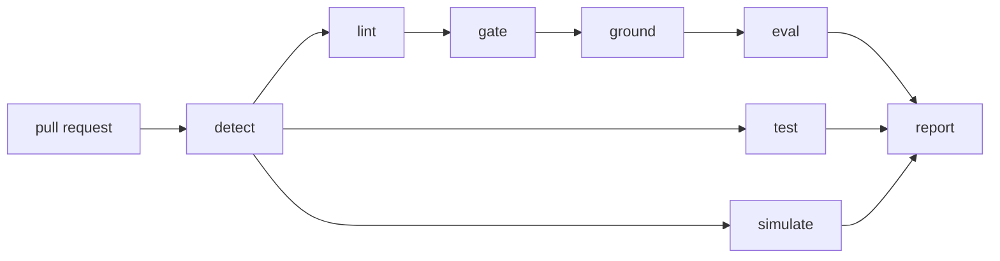

# loctu-data-platform

[](https://github.com/loctu0402/loctu-data-platform/actions/workflows/ci.yml)


An end-to-end analytics engineering monorepo for a fictional super-app with two businesses: a savings wallet and a cloud-kitchen delivery operation. It follows the way I build at work. One repository holds the dbt models, the semantic layer, the orchestration and the daily report, along with the knowledge base and golden questions the AI agent is held to. A model change therefore ships together with its definitions and its tests.


## What is here

| Path | What it does |
|---|---|
| `ingestion/` | Loads the bronze datasets. In this repo it generates synthetic source data, with dates that roll forward to yesterday. |
| `dbt/` | BigQuery models in three layers. Silver cleans and joins, gold holds the contracted marts. |
| `semantic/cube/` | Cube models over the gold marts, each metric defined once. |
| `airflow/dags/` | The daily DAG: freshness, silver, gold, golden eval, report. Failures post to chat. |
| `report/` | Expected-value model and the daily email and Google Chat card. |
| `kb/` | Knowledge base per business area: one atom per metric, gold table and trap, a changelog and owners. |
| `evals/` | Golden question set: a case template and 30 cases, each with gold SQL, an independent silver check and a rubric. |
| `tools/` | The CI rounds as small Python tools: detect, lint, gate, ground, eval and report. |
| `.github/` | CI and CD workflows and CODEOWNERS. |
| `.claude/skills/` | How the agent answers a question and how an engineer ships a model change. |
| `deploy/` | CD to the Airflow VM: runner setup, release sync with an atomic switch, smoke check. |

## How a day runs

1. Connectors land raw rows in `bronze_*`. dbt checks source freshness first and stops the run if a source is late.
2. Silver turns the ledger into one row per account per day with an end-of-day balance and a lifecycle state.
3. Gold builds the marts behind enforced contracts. Tests check that the balance moves only by booked flows, and that every `'all'` row of a cube equals the fact table.
4. The golden eval runs each question twice, once from gold and once from silver, and fails if the answers differ.
5. The report compares yesterday's flows with an expected value and a walk-forward control band, then sends the email and the chat card. It waits if gold is not complete.

## Knowledge base

Each business area under `kb/` is a folder an analyst can browse. Its `index.md` routes to one atom per metric, one per gold table and one per trap, and a changelog records the dated events that move the numbers. A new atom starts from `kb/_template/`.

```
kb/
├── rules.md          answering rules for every area
├── _template/        index, metric, table, gotcha and changelog shapes
├── savings/          6 metrics, 4 tables, 4 gotchas, changelog
│   ├── index.md
│   ├── metrics/      balance.md, net_flow.md, deposit_conversion.md, ...
│   ├── tables/       fct_savings_daily.md, agg_savings_flow_daily.md, ...
│   └── gotchas/      snapshots-read-the-last-day.md, ...
└── kitchen_ops/      4 metrics, 2 tables, 3 gotchas, changelog
```

The frontmatter of a metric atom is the one machine-readable definition: model, type, numerator, denominator, filters, columns, grain and period rule. The body explains the same metric to a person, as in [the on-time delivery rate](kb/kitchen_ops/metrics/on_time_rate.md). The gates read the same file, so prose and checks cannot disagree. The Source contract table must list exactly the frontmatter columns, and each of those columns must exist in the model's dbt contract. Each area names its owners in its index, and the gate fails when they differ from CODEOWNERS.

## Golden eval

The 30 cases live under `evals/golden/<area>/`, one file each, in the shape of `evals/template_case.yaml`. An answerable case holds the question as a stakeholder asks it and the expected SQL against gold. It also holds a check SQL that recomputes the answer from silver alone, and a rubric naming the metric, filters, grain and aggregation an answer must use. Four cases ask for something the KB does not hold, such as customer lifetime value, and the agent must refuse them.

Offline, `tools/eval_golden.py` checks every case against the template and confirms that the expected SQL reads the metric's own model. It also confirms that the check never reads gold, that every metric has at least two cases and every area at least one refusal, and that no refusal asks for a metric the KB has since defined. Live, it runs both queries on BigQuery and fails when gold and silver differ by more than half a percent. The rubric is what an agent's answer is graded against. This repo does not run the agent itself.

## CI rounds

Every pull request starts with `detect`, which maps each changed file to a unit and decides which rounds the change needs. A change to the KB alone never lints SQL, and a README change runs nothing. The lint, gate, ground and eval rounds run in order, and a failed round stops the ones after it.



| Round | What it checks | Runs when a change touches |
|---|---|---|
| lint | SQLFluff on dbt SQL, Python and shell syntax, YAML, and every golden SQL parsed as BigQuery | any file of those kinds |
| test | pytest for the report, the expected-value model and the CI tools | report, tests or tooling |
| gate | a typed, enforced contract on every gold model, KB atoms against their templates, definition of done, links and owners | dbt or a KB area |
| ground | every KB metric and table atom against the dbt contract columns and types | a KB area, or a model whose downstream reaches its tables |
| eval | golden cases offline, then live on BigQuery when the `GCP_SA_KEY` secret exists | a KB area, its golden cases, or the models behind them |
| simulate | the deploy sync, run twice, and the smoke check on a hosted runner | deploy scripts |
| report | one table as the job summary and as a pull request comment, with the code owners of each unit | always |

A dbt change routes through the manifest. `detect` finds the nodes a changed file defines and walks the manifest's `child_map` to everything downstream. An edit to `stg_kitchen__orders.sql` therefore gates and grounds `kitchen_ops`, names the exposures it reaches and leaves `savings` alone. A change to `tools/`, `.github/` or the Makefile runs every round on every area. `make plan` prints the same routing for your branch.

CODEOWNERS gives each KB area, golden area, the dbt project, the deploy scripts and the tooling their owners, and the report lists who must approve. This repo has one maintainer, so every line names the same account. The deploy job runs in the `production` environment. Two repository settings complete the approval path: branch protection on `main` that requires a code owner review and the `report` check, and a required reviewer on `production`.

## Design choices

- **Grain-safe aggregates.** Dashboard tables use `GROUP BY CUBE` and keep an `'all'` row for every cut, so distinct accounts are counted at each grain and never summed. On BigQuery the date goes inside the cube and is pinned with `HAVING GROUPING(date) = 0`.
- **Rates are never stored.** Each rate keeps its numerator and denominator, so any roll-up recomputes it correctly.
- **Balances are semi-additive.** A week or a month reads its last day, in SQL, in Cube and in the knowledge base.
- **Contracts on every gold model.** A changed type or a dropped column fails the build before a dashboard sees it.
- **The knowledge base cannot drift.** CI fails when a metric reads a column outside its model's contract, when a table atom's columns or types differ from the contract, or when a metric has fewer than two golden cases.

## Deploy

When CI passes on `main`, the `deploy` workflow syncs the commit to the Airflow VM through a self-hosted runner labelled `airflow-vm`.

1. `deploy/sync_release.sh` copies the repo into `releases/<sha>` with a checksum-based rsync, then repoints `current` in one atomic rename, so Airflow never reads a half-copied DAG folder.
2. Each deploy writes a manifest with the commit and the changed files, and the last five releases stay on disk for rollback.
3. `deploy/smoke_check.sh` confirms the live release is the expected commit, dbt parses against prod, and Airflow imports `platform_daily` without errors.

The `simulate` job runs the same sync and smoke check on a GitHub-hosted runner, so every merge proves the deploy path, and CI runs it on any pull request that changes `deploy/`. The real `deploy` job waits for a reviewer on the `production` environment. It switches on once the repository variable `AIRFLOW_VM_ENABLED` is `true` and a runner is registered with `deploy/install_runner.sh`.

## Lineage


Generated from the dbt manifest with `make lineage`.

## Run it

### On a laptop, with no warehouse

Every round except the live eval runs offline. dbt parses with the BigQuery adapter without connecting, so no project or credentials are needed.

```bash
pip install -r requirements.txt
make check      # parse, lint, test, gate, ground and eval on every file
make plan       # the units and rounds your branch touches against origin/main
```

Each round also runs alone: `make lint`, `make test`, `make gate`, `make ground` and `make eval`.

### With a BigQuery project

These steps create datasets and run queries in a Google Cloud project you own.

```bash
export GCP_PROJECT_ID=<your-project>
gcloud auth application-default login
make bronze     # synthetic sources into the bronze_* datasets
make build      # source freshness, then dbt build into dbt_dev_silver and dbt_dev_gold
make golden     # every golden case on gold, compared with its recompute on silver
GOLD_DATASET=dbt_dev_gold make report
```

### What CI proves and what needs your project

CI proves what can be checked without data, on GitHub-hosted runners. The dbt project parses and its SQL passes SQLFluff. Every gold model declares a typed contract, and every KB atom matches its template and its model's contract. The golden cases are well formed and cover every metric. The report and expected-value code pass their tests, and the release sync and smoke check work.

Everything that touches data needs your own GCP project: loading bronze, and building the models, which is where BigQuery enforces the contracts and runs the data tests. So do comparing gold with silver on real rows, sending the report and running the DAG on Airflow. The live eval joins CI once the repository has a `GCP_SA_KEY` secret and a `GCP_PROJECT_ID` variable.

The data is synthetic and contains no real customers, orders or company figures.
