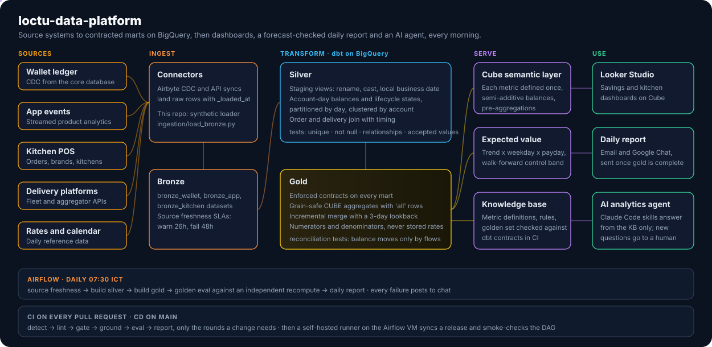
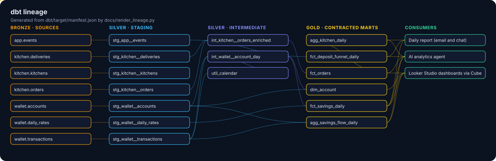

# Saola data platform

[](https://github.com/loctu0402/saola-data-platform/actions/workflows/ci.yml)


An end-to-end analytics engineering monorepo for Saola, a fictional super-app with two businesses: a savings wallet and a cloud-kitchen delivery operation. It follows the way I build at work: one repository holds the dbt models, the semantic layer, the orchestration, the daily report and the knowledge base the AI agent answers from, so a model change ships together with its definitions.



## What is here

| Path | What it does |
|---|---|
| `ingestion/` | Loads the bronze datasets. In this repo it generates synthetic source data, with dates that roll forward to yesterday. |
| `dbt/` | BigQuery models in three layers. Silver cleans and joins, gold holds the contracted marts. |
| `semantic/cube/` | Cube models over the gold marts, each metric defined once. |
| `airflow/dags/` | The daily DAG: freshness, silver, gold, golden eval, report. Failures post to chat. |
| `report/` | Expected-value model and the daily email and Google Chat card. |
| `agent/` | Knowledge base, golden question set and the gate that keeps both in line with the dbt contracts. |
| `.claude/skills/` | How the agent answers a question and how an engineer ships a model change. |
| `deploy/` | CD to the Airflow VM: runner setup, release sync with an atomic switch, smoke check. |

## How a day runs

1. Connectors land raw rows in `bronze_*`. dbt checks source freshness first and stops the run if a source is late.
2. Silver turns the ledger into one row per account per day with an end-of-day balance and a lifecycle state.
3. Gold builds the marts behind enforced contracts. Tests check that the balance moves only by booked flows, and that every `'all'` row of a cube equals the fact table.
4. The golden eval runs each question twice, once from gold and once from silver, and fails if the answers differ.
5. The report compares yesterday's flows with an expected value and a walk-forward control band, then sends the email and the chat card. It waits if gold is not complete.

## Design choices

- **Grain-safe aggregates.** Dashboard tables use `GROUP BY CUBE` and keep an `'all'` row for every cut, so distinct accounts are counted at each grain and never summed. On BigQuery the date goes inside the cube and is pinned with `HAVING GROUPING(date) = 0`.
- **Rates are never stored.** Each rate keeps its numerator and denominator, so any roll-up recomputes it correctly.
- **Balances are semi-additive.** A week or a month reads its last day, in SQL, in Cube and in the agent's rules.
- **Contracts on every gold model.** A changed type or a dropped column fails the build before a dashboard sees it.
- **The knowledge base cannot drift.** CI fails when a KB metric points at a column that is not in its model's contract, or when a metric has no golden case.

## Deploy

When CI passes on `main`, the `deploy` workflow syncs the commit to the Airflow VM through a self-hosted runner labelled `airflow-vm`.

1. `deploy/sync_release.sh` copies the repo into `releases/<sha>` with a checksum-based rsync, then repoints `current` in one atomic rename, so Airflow never reads a half-copied DAG folder.
2. Each deploy writes a manifest with the commit and the changed files, and the last five releases stay on disk for rollback.
3. `deploy/smoke_check.sh` confirms the live release is the expected commit, dbt parses against prod, and Airflow imports `saola_daily` without errors.

The `simulate` job runs the same sync and smoke check on a GitHub-hosted runner, so every merge proves the deploy path. The real `deploy` job switches on once the repository variable `AIRFLOW_VM_ENABLED` is `true` and a runner is registered with `deploy/install_runner.sh`.

## Lineage



Generated from the dbt manifest with `make lineage`.

## Run it

```bash
pip install -r requirements.txt
make check                      # dbt parse, SQLFluff, knowledge gate, tests, DAG compile
```

With a BigQuery project of your own:

```bash
export SAOLA_GCP_PROJECT=<your-project>
gcloud auth application-default login
make bronze                     # synthetic sources into bronze_*
make build                      # dbt source freshness and build into dbt_dev_silver and dbt_dev_gold
make golden                     # golden questions against an independent recompute
SAOLA_GOLD_DATASET=dbt_dev_gold make report
```

The data is synthetic and contains no real customers, orders or company figures.
